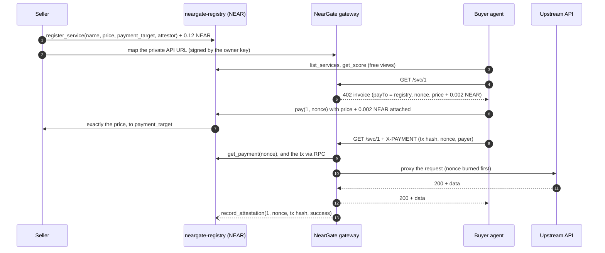

# NearGate

**Pay-per-call APIs for AI agents on NEAR.** NearGate puts an HTTP 402 paywall (x402) in front of any HTTP API and settles every call in NEAR through its own registry contract. An agent reads the 402 invoice, pays the registry, retries with the transaction as proof and gets the response. The gateway then records an attestation on chain, so every service carries a score backed by real payments.

An AI agent can hold a NEAR account, but it cannot sign up for an API key or type in a card number. With NearGate it pays per call by itself: no account at the seller, no API key, no subscription. Its owner keeps control: the agent can run on a NEAR function-call key that can spend only a prepaid escrow, the NearGate client refuses any invoice above the cap it is given (`--max` on the CLI, `maxNear` over MCP), and the gateway can pay the agent's gas (NEP-366).

Built during NEAR HACKATHON ([nearhackathon.com](https://nearhackathon.com)) as the NEAR port of AgentGate, the team's earlier x402 gateway. What existed before and what is new: [Built on AgentGate](#disclosure).

**Contents:** [Try it](#try-it-no-keys) · [Do X → see Y](#do-x--see-y) · [How it works](#how-it-works) · [NEAR features](#near-features-used) · [Testnet deployment](#deployed-on-near-testnet) · [Tests](#tests) · [Error codes](#error-codes) · [Layout](#repository-layout) · [Built on AgentGate](#disclosure) · [Limits](#limits-and-trust-model) · [License](#license)

## Try it (no keys)

```bash
npm install && npm run demo
```

Needs Node ≥ 22.22.2 (near-api-js 7.4.0 requires it). The demo boots a NEAR mock chain, the gateway and a sample API in one process, wraps the API as service #1 at 0.5 NEAR, buys one call and exits 0. It needs no key and no network:

```text
> neargate@0.1.0 demo
> tsx scripts/demo.ts

registered service #1
402 invoice: 0.5 NEAR + 0.002 NEAR storage
paid: tx D7w5vMa1uqLrMet4z21dqbr6eCNGji7Vy2f7qXM64JYT
served: 200
attested: tx A8nVeRKNSqWF2kyNvokzr23MN67tij8jf376PAnCjAbk
score: 1/1 (new)
```

The two hashes are the buyer's `pay` and the gateway's `record_attestation` on the mock chain; they change on every run.

On NEAR testnet, also with no key:

```bash
npm run neargate -- list                  # the live catalog of the registry neargate-1112-registry.testnet
curl -i https://<gateway-host>/svc/1      # an HTTP 402 with the x402 invoice
```

> Pending the hosting: `<gateway-host>` and `<dashboard-host>` are placeholders. The registry is deployed, but it holds no service until the seed runs through the hosted gateway, so for now `list` prints an empty catalog.

## Do X → see Y

### Locally, on the mock chain (no keys)

Terminal 1 starts the mock chain, the gateway (with the gasless relayer on) and the sample API, seeds one paid call, prints two `export MOCK_…` lines and stays up. Terminal 2 serves the dashboard at http://localhost:3000. Paste the export lines into terminal 3.

```bash
RELAYER_ENABLED=1 GATEWAY_ACCOUNT_ID=gateway.mock npm run dev:seed   # terminal 1
npm run dev:dashboard                                                # terminal 2
```

| Do (terminal 3) | See |
|---|---|
| `npm run neargate -- list --mode mock` | `1  RWA FX & Gold Oracle  0.5  1/1  new  yes` |
| `curl -i http://localhost:4021/svc/1` | `HTTP/1.1 402 Payment Required` and the x402 body: `payTo` the registry, `maxAmountRequired` (0.502 NEAR in yocto), a one-time `nonce`, `relayer: gateway.mock` |
| `npm run neargate -- buy 1 --max 1 --mode mock` | the API's JSON on stdout; on stderr `paid: 0.5 NEAR + 0.002 NEAR storage`, the payment tx and `status: 200`. The score of #1 on the dashboard goes up by one. |
| `npm run neargate -- escrow deposit 2 --mode mock` | `escrow: 1.998 NEAR` (the first deposit keeps 0.002 NEAR for the escrow's storage) |
| `npm run neargate -- buy 1 --from-escrow --max 1 --mode mock` | `from: escrow (nothing attached; the escrow was debited)` |
| `npm run neargate -- buy 1 --gasless --max 1 --mode mock` | `relayed: gasless — gateway.mock relayed the signed pay_from_escrow and paid the gas` |
| `npm run neargate -- wrap http://localhost:4010/feed --price 0.25 --name "Gold Spot Feed" --mode mock` | `service id: 2`, the endpoint `http://localhost:4021/svc/2` and the register tx |
| `MCP_CMD="npx tsx packages/cli/src/bin.ts mcp --mode mock" scripts/mcp.sh tools` | the five MCP tools: `neargate_list_services`, `neargate_get_service`, `neargate_get_invoice`, `neargate_escrow_balance`, `neargate_buy` |
| `MCP_CMD="npx tsx packages/cli/src/bin.ts mcp --mode mock" scripts/mcp.sh list` | the catalog as the MCP tool `neargate_list_services` returns it |

### On NEAR testnet (needs a funded testnet account and its key)

The CLI reads an account's key from `~/.near-credentials/testnet/<account>.json`, the legacy keychain that near-cli-rs writes with `save-to-legacy-keychain` (or from `--key-file`). A new faucet-funded account:

```bash
near account create-account sponsor-by-faucet-service <you>.testnet autogenerate-new-keypair --signature-scheme ed25519 save-to-legacy-keychain network-config testnet create
```

| Do | See |
|---|---|
| **Buy:** `npm run neargate -- buy 1 --account <you>.testnet --max 0.05` | the response on stdout; on stderr the price + 0.002 NEAR storage, the `pay` tx and its nearblocks link. Seconds later the gateway's attestation lands and the service's score on the dashboard goes up by one. |
| **Sell:** `npm run neargate -- wrap https://<your-api> --price 0.01 --name "My API" --account <you>.testnet --attestor neargate-1112-gateway.testnet --gateway https://<gateway-host>` | the service id, its public `/svc/<id>` endpoint and the register tx (0.12 NEAR deposit). Your API's URL never goes on chain: it is sent only to the gateway, in a request signed with your full-access key. |
| **Agent key:** `npm run neargate -- escrow deposit 0.5 --account <you>.testnet`, then `npm run neargate -- agent-key add --allowance 0.25 --account <you>.testnet` | the escrow balance; then the key file `~/.near-credentials/testnet/<you>.testnet.neargate-agent.json` (mode 0600) and the AddKey tx. The agent buys with `npm run neargate -- buy 1 --from-escrow --account <you>.testnet --key-file <that file> --max 0.05`. |
| **Gasless:** `npm run neargate -- buy 1 --gasless --account <you>.testnet --key-file <that file> --max 0.05` | `relayed: gasless — neargate-1112-gateway.testnet relayed the signed pay_from_escrow and paid the gas`. Your account's balance does not move; the escrow pays price + 0.002 NEAR. Needs a gateway running with `RELAYER_ENABLED=1`. |
| **MCP:** `npm run build -w packages/cli`, then add the server below to `claude_desktop_config.json` | Claude Desktop gets five tools: `neargate_list_services`, `neargate_get_service`, `neargate_get_invoice`, `neargate_escrow_balance` and `neargate_buy` (capped by `maxNear`; `fromEscrow` and `gasless` work with an agent key) |

```json
{ "mcpServers": { "neargate": { "command": "node", "args": ["/path/to/neargate-app/packages/cli/dist/bin.js", "mcp", "--registry", "neargate-1112-registry.testnet", "--account", "<you>.testnet", "--key-file", "~/.near-credentials/testnet/<you>.testnet.neargate-agent.json"] } } }
```

Every flag, the MCP tools in full and the docs pages behind them: [packages/cli/README.md](packages/cli/README.md), or `/docs` on the dashboard (`npm run dev:dashboard`, or `https://<dashboard-host>/docs`).

## How it works

1. **Register.** A seller calls `register_service` on `neargate-registry` with a name, a price in yoctoNEAR, a payment target, an attestor and the gateway's base URL, and attaches a 0.12 NEAR deposit that prepays the service's record, its score and its full attestation list. The API's own URL never goes on chain: the owner maps it on the gateway with a request signed by a full-access key of the owner account.
2. **Challenge.** An unpaid `GET /svc/<id>` answers `402` with an x402 V1 body: `payTo` is the registry, `maxAmountRequired` is the price + 0.002 NEAR, and `extra` carries a single-use `nonce` and an expiry.
3. **Pay through the registry.** `pay(service_id, nonce)` forwards exactly the price to the seller's payment target, keeps the 0.002 NEAR storage fee for the payment record and refunds any excess. A nonce can be paid once, ever.
4. **Prove, verify, serve.** The agent retries with an `X-PAYMENT` header (base64 JSON: tx hash, nonce, payer). The gateway reads the registry's `get_payment(nonce)` and, live, the transaction itself (signer, receiver, method, arguments), burns the nonce, proxies the request and returns the response.
5. **Attest and score.** The gateway calls `record_attestation`. The registry accepts it only for a payment it holds, once, and never for a payment by the owner or the payment target. The score `(total, success)` gives the tier: new, reliable (≥ 5 calls, ≥ 90 % ok) or trusted (≥ 25 calls, ≥ 95 % ok).



The buyer can pay on three rails. The invoice and the payment record are the same on all three:

| Rail | What the buyer sends | Gas paid by | Can be signed by |
|---|---|---|---|
| Deposit (default) | `pay(service_id, nonce)` with price + 0.002 NEAR attached; then the tx hash as proof | the buyer | a full-access key |
| Escrow (`--from-escrow`) | `pay_from_escrow(service_id, nonce)` with nothing attached (the escrow is debited); then the tx hash | the buyer | a full-access key or an agent key |
| Gasless (`--gasless`) | that `pay_from_escrow`, signed as a NEP-366 delegate, as the proof itself; the gateway relays it | the gateway | a full-access key or an agent key |

The full spec, every 402 reason and the gateway routes are on the dashboard's `/docs/protocol` page ([source](dashboard/app/docs/protocol/page.tsx)).

## NEAR features used

| NEAR feature | How NearGate uses it |
|---|---|
| Own smart contract (Rust, near-sdk 5.30.1) | `neargate-registry` ([contracts/](contracts/README.md)): the service catalog, pay-through payments, the escrow, attestations, scores and an activity ring. It has no admin. Every byte a caller makes it store is prepaid by that caller (0.12 NEAR per service, 0.002 NEAR per payment and per escrow entry), measured with `env::storage_usage()` and refused with `ERR_STORAGE_EXCEEDED` past the budget. |
| NEP-297 events | `EVENT_JSON` logs with `standard: "neargate"` for `service_registered`, `payment`, `attestation`, `service_status`, `attestor_changed`, `escrow_deposit` and `escrow_withdraw`. |
| Function-call access keys | `npm run neargate -- agent-key add` gives an agent a key that NEAR itself restricts to the registry and the one method `pay_from_escrow`: it spends the prepaid escrow and nothing else, plus gas from the account's own balance up to its allowance. A function-call key cannot attach a deposit, so it could never sign `pay` (which carries the price as a deposit); that is why the escrow exists and `pay_from_escrow` attaches nothing. `withdraw_escrow` needs exactly 1 yoctoNEAR attached, so only a full-access key can take the escrow back. The sandbox test `agent_function_call_key_pays_from_escrow_only` proves both refusals (`DepositWithFunctionCall`, `MethodNameMismatch`). |
| NEP-366 meta transactions | The gasless rail: the agent signs its `pay_from_escrow` as a `SignedDelegate` and sends it as the payment proof. Before relaying, the gateway checks its shape, its signature, that the key is the payer's and may call `pay_from_escrow`, its nonce and the escrow. It then relays it and pays only the gas. NEAR makes a relayer pay any deposit a relayed call attaches, so the gateway relays this one zero-deposit call and nothing else. Shipped: tested end to end on the mock chain (`e2e/gasless.test.ts`); its first testnet run comes with the deploy. |
| Access keys as identity | Self-map: the gateway accepts a seller's private API URL only in a request signed by a key that `view_access_key` shows is a FullAccess key of the service owner. |

The track hints this touches: AGENT COMMERCE (07 Agent Economy: agents paying for APIs), AGENT SECURITY and FUNCTION CALL KEYS (06 AI Security & Defense), META TRANSACTIONS (08 Real-World Money).

### NEAR Agent Connect (not integrated)

NearGate is the paying side of agentic commerce on NEAR. [Agent Connect](https://nearbuilders.org/build#agent-connect) (the NEAR Intents agent API) is a complementary agent wallet with owner rules: an agent withdraws within its owner's limits to its own NEAR account, then pays NearGate invoices from there, and NearGate's own caps (`--max`, `maxNear`, `BUDGET_EXCEEDED`, the escrow) add to those custody-side rules. It is not integrated: Agent Connect is a mainnet-only, experimental beta, and its owner-policy actions are transfers and withdrawals, not contract calls.

## Deployed on NEAR testnet

**Deployed on 2026-11-12:** the registry and its four accounts. **Pending the hosting:** the gateway and dashboard hosts, and the register → pay → attest transactions that the seed writes through the hosted gateway, are still placeholders.

| What | Value |
|---|---|
| Registry contract | [`neargate-1112-registry.testnet`](https://testnet.nearblocks.io/address/neargate-1112-registry.testnet) (the CLI's default registry) |
| Deploy + `new()` | [`8vM38YTz…`](https://testnet.nearblocks.io/txns/8vM38YTzoissBoq38UN4gTDmyjoFa3451WGj4krPHit) |
| Gateway | `https://<gateway-host>`, run by `neargate-1112-gateway.testnet` (it signs the attestations and relays gasless payments) |
| Dashboard | `https://<dashboard-host>`: catalog, service pages, activity feed and `/docs` |
| `register_service` | `<tx-register>` |
| `pay` | `<tx-pay>` |
| `record_attestation` | `<tx-attest>` |

Running your own deployment (testnet; needs near-cli-rs, and cargo-near for the deploy):

| Script | Does |
|---|---|
| `npm run near:bootstrap` | creates four faucet accounts (registry, seller, gateway, buyer) with keys in `~/.near-credentials/testnet/`; `DRY_RUN=1` prints every command and touches no network |
| `npm run near:deploy` | builds `neargate-registry` with cargo-near and deploys it with `new()` (no arguments, no admin) |
| `npm run dev:live` | the gateway in live mode against that registry |
| `npm run near:seed` | one real register → pay → attest through the running gateway, with the three nearblocks links |
| `npm run smoke:live` | a read-only check: list, one service, an unpaid 402 |

Hosting the gateway and the dashboard (pm2, Vercel or docker compose): [deploy/README.md](deploy/README.md). Contract build, ABI and storage accounting: [contracts/README.md](contracts/README.md).

## Tests

| Suite | Command | Tests |
|---|---|---|
| TypeScript: every package, the e2e flows on the mock chain (in-process servers on port 0), the dashboard | `npm test` | 1,200+ (vitest); no network |
| Contract: unit tests and near-workspaces sandbox tests | `cd contracts && cargo test` (build the wasm first: [contracts/README.md](contracts/README.md#test)) | 55+ |
| Typecheck, dashboard build, demo | `npm run typecheck`, `npm run build`, `npm run demo` | |

The e2e suites cover the full loop, the escrow and gasless rails, the owner-signed self-map, the CLI as a subprocess and the demo's six lines. Two guards keep this README honest: `e2e/readme.test.ts` checks every `npm run` script, relative link and live value in it, and `e2e/copy-guard.test.ts` scans every tracked file for the previous chain's vocabulary and the retired hosts. In the contract suite, `pay_refunds_excess_and_forwards_exact_price`, `self_paid_payment_cannot_be_attested_onchain` and `pay_storage_cost_is_covered_by_fee` run against a real NEAR sandbox node.

## Error codes

The ones a buyer or seller meets most. The CLI prints `error: <CODE>: <message>`; MCP tools return the same code first.

| Code | Meaning | What to do |
|---|---|---|
| `BUDGET_EXCEEDED` | The invoice total (price + 0.002 NEAR) is above `--max`, `maxNear` or the agent's budget. | Nothing was paid. Raise the cap or pick another service. |
| `PAID_NOT_SERVED` | The `pay` went through, but the gateway did not serve the call. The error names the tx and the nonce. | Do not buy again: that pays twice. Re-present the same proof once the gateway answers: [the `curl` below](#re-present-a-paid-proof). |
| `GASLESS_NOT_SERVED` | `--gasless`: the gateway did not serve the call, after `buy` re-presented the signed delegate for as long as the relay was settling (up to 150 s). The escrow paid only if the gateway's relay landed; the message says whether it did not, or may have. | If it may have paid, or after `invoice_used`, check the relay tx it links and `escrow balance` before buying again: buying again signs a new payment. |
| `PRICE_MISMATCH` | Escrow or gasless: the invoice total is not the on-chain price + 0.002 NEAR. | Nothing was sent. Do not pay this gateway's invoice from the escrow. |
| `ERR_ESCROW_INSUFFICIENT` | The escrow holds less than price + 0.002 NEAR. | `escrow deposit` more. |
| `RELAYER_UNAVAILABLE` | `--gasless`, but the gateway offers no relayer. | Use `--from-escrow`. |
| `TX_TIMEOUT` | A transaction was sent, but its outcome is unknown. | Check the named tx on nearblocks before retrying. |
| `CONFIG_INVALID` | A bad flag or variable, e.g. live mode with no registry id. | Set `REGISTRY_CONTRACT_ID` (or pass `--registry`). |
| `GATEWAY_REQUIRED` | A live `wrap` with no `--gateway` and no hosted default. | Pass `--gateway`; the registry stores it for good. |
| `settlement_pending` (402) | The payment is not visible yet, or a gasless relay is in flight, timed out or not read yet. | Retry the same proof after `Retry-After`; `buy --gasless` does it on its own. |
| `tx_mismatch` (402) | The tx is not a successful `pay` of this nonce and service, signed by the named payer. | Present the right transaction. |
| `ERR_*` (contract) | The registry refused a call, e.g. `ERR_NONCE_USED`, `ERR_SELF_PAYMENT`, `ERR_DEPOSIT_TOO_LOW`. | The full list: [contracts/README.md](contracts/README.md#errors). |

<a id="re-present-a-paid-proof"></a>After `PAID_NOT_SERVED`, re-present the paid transaction (`pay` or `pay_from_escrow`): send the same request again with an `X-PAYMENT` header, the base64 of the JSON below (the format is on the dashboard's `/docs/protocol` page, [source](dashboard/app/docs/protocol/page.tsx)). The gateway serves it once; after that, the nonce answers `invoice_used`.

```bash
TX=<tx hash> NONCE=<nonce> PAYER=<you>.testnet
curl -i -H "X-PAYMENT: $(printf '{"x402Version":1,"scheme":"exact","network":"near-testnet","payload":{"kind":"tx","transaction":"%s","nonce":"%s","payer":"%s"}}' "$TX" "$NONCE" "$PAYER" | base64 | tr -d '\n')" https://<gateway-host>/svc/<id>
```

## Repository layout

```text
contracts/registry/           neargate-registry, the NEAR contract (Rust, near-sdk 5.30.1)
contracts/integration-tests/  near-workspaces sandbox tests
packages/shared/              types, config, yocto money, the x402 codec, trust tiers
packages/chain/               the NEAR client (near-api-js 7.4.0) and the mock-chain client
packages/devnet/              the in-memory mock chain; it applies the registry's rules     :4030
packages/middleware/          the gateway: 402 paywall, payment checks, relay, attestations   :4021
packages/client/              fetchPaid: 402 → pay (deposit, escrow or gasless) → retry, with caps
packages/cli/                 npm run neargate -- list, status, wrap, map, buy, escrow, agent-key, mcp
packages/buyer-agent/         an LLM buyer (Claude with ANTHROPIC_API_KEY, else a deterministic MockLlm)
packages/oracle/              the sample API the demo wraps (USD/IDR and gold)               :4010
dashboard/                    Next.js: catalog, service pages, activity, docs              :3000
scripts/                      demo.ts, dev.ts, live.ts, near/ (bootstrap, deploy, seed, smoke), mcp.sh
e2e/                          end-to-end tests and the README and copy guards
deploy/                       the hosting runbook
```

## Built on AgentGate (Casper)

<a id="disclosure"></a>

NearGate is the NEAR port of AgentGate, the team's x402 gateway for Casper, built before this event. This repository carries AgentGate's full git history, so the line between old and new is exact:

| | |
|---|---|
| Pre-hackathon baseline | tag `pre-hackathon` = `8dba09a` (2026-07-24), the last Casper commit |
| Hackathon work | every commit after it, all from 2026-11-11 on, inside the NEAR HACKATHON window |
| The diff | [pre-hackathon...hackathon-submission](../../compare/pre-hackathon...hackathon-submission) on GitHub; in a clone, `git diff --stat pre-hackathon hackathon-submission` |

**Built in the window:** the `neargate-registry` contract with its escrow and sandbox tests (it replaces the Casper contracts); the NEAR client on near-api-js and the mock chain's NEAR mirror; the NEAR x402 rail (pay through the registry, verified by view and by transaction) and the NEAR-key self-map; the escrow, the restricted agent keys and the NEP-366 gasless relay; the CLI, MCP server, client and buyer agent on NEAR; the dashboard on NEAR; the testnet scripts, the hosting files, this README and the guards.

**Carried over from AgentGate and ported:** the monorepo layout and the product idea; the gateway's 402 proxy (invoice store, nonce burn, attestation queue and retries, SSRF guard, rate limits); the CLI and MCP structure; the buyer agent and its MockLlm; the mock-chain devnet idea; the sample oracle; the dashboard's Next.js shell. **Removed:** the Casper contracts, the casper-js-sdk and CSPR.cloud client, and the CEP-18 facilitator rail. Internal package and env names keep the AgentGate prefix: the `@agentgate/*` workspaces, the CLI workspace `@neargate/cli`, `AGENTGATE_MODE` and `AGENTGATE_ADMIN_TOKEN`. NearGate publishes nothing to npm; the package of that name on npm is AgentGate's old CLI, so run the CLI from this repo with `npm run neargate -- …`.

**Libraries:** near-sdk 5.30.1 and near-workspaces 0.24.0 (contract and sandbox tests); near-api-js 7.4.0 and borsh (NEAR client); Express with helmet, express-rate-limit and undici (gateway); the MCP SDK (`@modelcontextprotocol/sdk`), commander and zod (CLI); Next.js 16, React 18, SWR and Tailwind CSS (dashboard); vitest, tsx, tsup and TypeScript. No project template was used; the baseline is AgentGate itself.

**AI code:** AI coding assistants were used throughout the window to write, test and review the code and the docs. The event's rules ask for this disclosure.

## Limits and trust model

| Limit | What it means |
|---|---|
| Testnet only | Nothing is deployed to mainnet, and the contract has not been audited. |
| The registry account still holds its full-access key | The contract has no admin method, but the account it is deployed on keeps the key it was deployed with, so that key can replace the code. Deleting the key would make the code final; it stays on testnet so fixes can ship. |
| A score's payments are trustless; its success flag is reported | The registry guarantees that every counted call is a real payment it received, counted once and never paid by the owner or the payment target. The `success` flag is whatever the service's attestor (the gateway) or its owner reports: the registry lets the owner attest too, so an owner can record a verdict before the gateway does. |
| The wash-trade guard covers only the owner and the payment target | A seller paying from a third account makes a real payment that counts. Each one costs at least the 0.002 NEAR fee, and the price returns to the seller. |
| A leaked agent key | can spend the whole escrow, on any active service, plus gas from the account balance up to the key's allowance. Keep both small; revoke the key by deleting it with the full-access key. |
| Tx proofs can be front-run | Once a buyer's `pay` transaction is public, anyone watching can present it first and receive the response; the buyer then gets `invoice_used` (`PAID_NOT_SERVED`). That is inherent to paying first and proving after. On the gasless rail nothing redeemable is public before the buyer's request reaches the gateway; between the relay landing and the burn the payment is public, and the gateway answers `invoice_used` to anything it did not relay itself. After a relay timeout the payment is public before the buyer's retry, so that retry can be front-run. |
| One gateway process | Receipts, rate limits, the relays not yet served and the delegate nonces relayed live in the gateway's memory, so run one instance. Without `INVOICE_STORE_PATH` a restart forgets open invoices. A restart always forgets the relays: the retry of a relay that landed before it gets `invoice_used`, and a delegate whose relay had not landed yet can be relayed again (NEAR runs it once, so it cannot pay twice, but that answer may not say it paid). Check `escrow balance` before buying again. |
| Native NEAR only | The registry stores up to four price options per service, but only native NEAR is settled; NEP-141 tokens are next. |

Security reports: [SECURITY.md](SECURITY.md). Contributing: [CONTRIBUTING.md](CONTRIBUTING.md).

## License

MIT, see [LICENSE](LICENSE).
